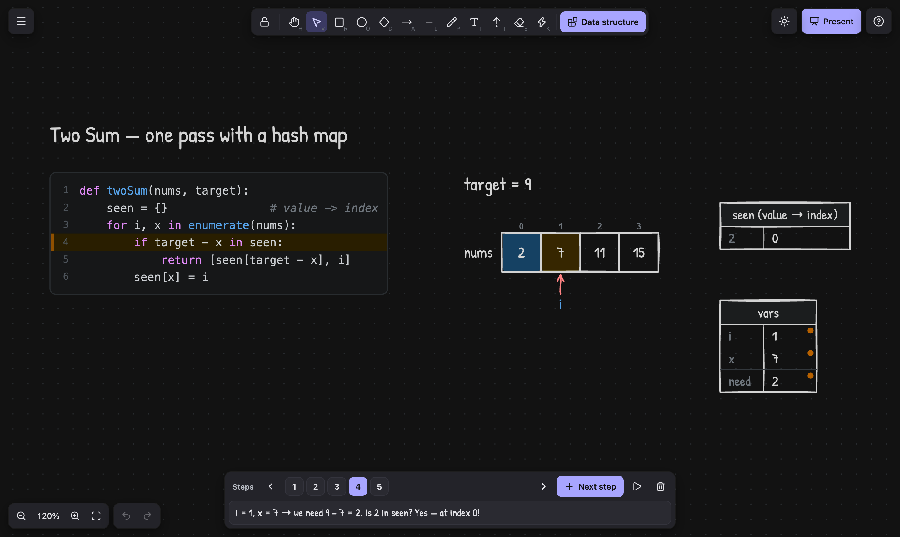
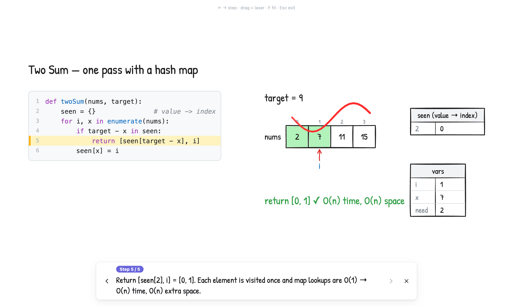

# dryrun

**An Excalidraw-style whiteboard for tracing DSA solutions step by step — built for coding interviews.**

Paste your solution, get the board it works on, then walk the interviewer through every iteration: move pointers,
colour cells, cross out old values, capture each step with a note, and present it with a laser pointer.





## Features

- **Data structures in one click** — arrays, stacks, queues, grids / DP tables, binary trees and N-ary (recursion)
  trees, linked lists, graphs, hash maps / variable tables, and syntax-highlighted code. Input in LeetCode formats.
- **Code → board** — insert a solution (Python, Java, C++, JS/TS, Go) and dryrun creates the structures it uses with
  sample values, an empty hash map / stack / queue / DP table for its locals, pointers for its index variables and a
  `vars` table for every scalar.
- **Tracing tools** — index pointers (`i`, `lo`/`hi`, `slow`/`fast`) that snap to cells and nodes, cell colours
  (current, visited, found…), whiteboard-style cross-out-and-rewrite (`i = 0̸ 1̸ 2`), a code "program counter", and
  automatic dots on values that changed since the previous step.
- **Steps & presenting** — snapshot the board after each iteration, add a note, play it back or present fullscreen;
  pointers slide between cells as you step.
- **Edit structures in place** — `+` / `×` buttons to grow or shrink anything; indices, colours and pointers follow
  the elements. The eraser removes exactly the value, cell or node under it.
- **Export & save** — PNG of a step, a "trace sheet" with every step and its notes, JSON save/open, autosave.
- Hand-drawn or clean lines, dark and light themes, undo/redo, keyboard shortcuts for everything.

## Quick start

```bash
npm install
npm run dev      # http://localhost:5173
npm run build    # typecheck + production build in dist/
```

The first launch opens a fully traced **Two Sum** example — press `]` to step through it, `Shift+P` to present.

## Tracing a problem in 60 seconds

1. `S` → **Code** → paste your solution → **Insert** (the structures and variables come with it).
2. Click a line of code to highlight it; move pointers with `←` / `→`; colour cells with `1`–`6`.
3. Press `N` for the next step, change what changed (`/` crosses out a value and lets you write the new one), and add
   a one-line note.
4. `Shift+P` to present; `←` / `→` to step, drag to point with the laser, `Esc` to exit.

| Key | Action | Key | Action |
| --- | --- | --- | --- |
| `S` | Insert data structure | `N` | Next step (snapshot) |
| `I` | Pointer tool | `[` `]` | Previous / next step |
| `1`–`6`, `0` | Colour / clear cells | `/` | Cross out & rewrite a value |
| `←` `→` | Move pointer / cell cursor | `↑` `↓` | Move code highlight |
| `E` | Eraser | `K` | Laser |
| `Shift+P` | Present | `?` | All shortcuts |

## Reference

1. **Insert a data structure** (`S`): array, stack, queue, grid / DP table, binary tree (LeetCode level order),
   general **tree (N-ary)** for recursion trees and tries (indented outline, or LeetCode `[1,null,3,2,4,null,5,6]`),
   linked list, graph (edge list, `->` directed, `:w` weights, or `[[0,1],[1,2]]`), hash map / variables, code.
   Inserting **Code** also sets up the board it works on (on by default, see the checkbox): parameters become structures
   with sample values (`nums` → `[2, 7, 11, 15]`, `grid`, `root`, `head`, `edges`…), local collections start empty
   (`seen = {}` → hash map, `stack = []`, `deque()`, `dp = [0] * (n + 1)`, 2-D DP tables with string headers), index
   variables (`i`, `lo`/`hi`/`mid`, `left`/`right`, `slow`/`fast`) become pointers, and all scalars go into a `vars`
   table. Works with Python, Java, C++, JS/TS and Go; it's pattern-based, so review and tweak what it creates.
2. **Add pointers** (`I`, then click a cell or node): `i`, `lo`, `mid`, `slow`… A pointer always points at a cell or
   node: drag it onto another one, or select it and press `←` / `→` to move it by one cell. It's removed together with
   what it points at. To point at anything else, draw an arrow (`A`). The name and the arrow have separate colours
   (red arrow, blue name by default; change either in the panel).
3. **Colour cells or nodes** with `1`–`6` (current, visited, found, removed, window, ignored); `0` clears.
   Shift-click to select several cells.
   **Cross out & rewrite** a value like on a whiteboard: select a cell (array, grid, hash-map/vars) or a linked-list
   node and press `/` (or the `/` button on it), then type the new value — the old one stays beside it with a slash
   through it (`i = 0̸ 1̸ 2`). Leaving the new value empty just keeps the value crossed out. Cells and list nodes
   show their last 3 crossed-out values; hash-map/vars entries show the whole history. Grid cells show their `r,c`
   coordinates in the corner (toggle in the panel).
4. **Next step** (`N`) snapshots the board; then edit it for the next iteration. Each step has a note.
   Values that changed since the previous step get an orange dot.
5. **Present** (`Shift+P`): fullscreen, `←` / `→` to step (pointers slide between cells), drag for the laser.

**Growing and shrinking structures.** Select a structure and use the on-canvas buttons:
`+` after an array's last cell appends an element, `+` on its bottom edge turns it into a grid; grids get `+` for a new
row/column, stacks push on top, hash maps add an entry, binary-tree nodes add a left/right child, N-ary tree nodes add
any number of children, list nodes insert after themselves and graph nodes add a connected neighbour. Select cells (or
a node) to get `×`: later elements shift down, and their indices, colours and pointers move with them. Removing a list
node relinks prev → next; removing a tree node removes its subtree.

Code blocks act as a program counter: click a line to highlight it, `↑` / `↓` moves the highlight.
Double-click (or `Enter`) edits any value; while editing a cell, `Tab` jumps to the next cell.

**Eraser** (`E`) removes only what's under it (outlined in red as you hover):
- on a **value** (current or crossed-out): just that value — the cell or node stays, empty, ready for a new value;
- elsewhere in a **cell / node**: the array element (later ones shift, pointers follow), the hash-map entry, the list
  node (relinked) or the tree node with its subtree; a grid cell's value; anything else goes whole.

Drag to mark several things — they're erased together on release, as one undo. Where the stroke starts decides what
it erases: start on a value to erase only values, start on a cell to remove only cells.

Plain drawing tools (shapes, arrows that bind to shapes, freehand, text) work as in Excalidraw.
Dark mode is the default; switch with the ☀/☾ button (top right) or `Alt+Shift+D`. PNG exports always use a
light background. Everything autosaves in the browser. From the menu you can save/open `.dryrun.json` files (older
`.dsatrace.json` files open too), export the current step as a PNG, or export a **trace sheet** (all steps and notes
in a single PNG).

## Code map

Built with React, TypeScript, Vite, zustand and rough.js.

| File | Purpose |
| --- | --- |
| `src/types.ts` | Element and document model (a document is a list of steps, each a full element snapshot) |
| `src/store.ts` | Zustand store: history, step timeline, viewport, persistence |
| `src/structures.ts` | Element factories and input parsers / layouts for trees, lists, graphs, grids |
| `src/structureOps.ts` | Adding / removing elements, cross-outs and the eraser, keeping indices, colours and pointers in step |
| `src/codeScaffold.ts` | Reads a pasted solution and builds the structures, pointers and `vars` table it needs |
| `src/geometry.ts` | Bounds, cell boxes, arrow binding, pointer placement |
| `src/actions.ts` | Tracing operations: marks, pointer stepping, array ops, code cursor |
| `src/shortcuts.ts` | Keyboard shortcuts and presentation mode |
| `src/render/` | Pure SVG `Scene` (shared by canvas and export), rough.js primitives, code highlighter |
| `src/components/` | Canvas interactions, +/× handles, inline editor, toolbar, properties panel, timeline, dialogs |
| `src/exporter.ts` | JSON save/open, PNG and trace-sheet export |
